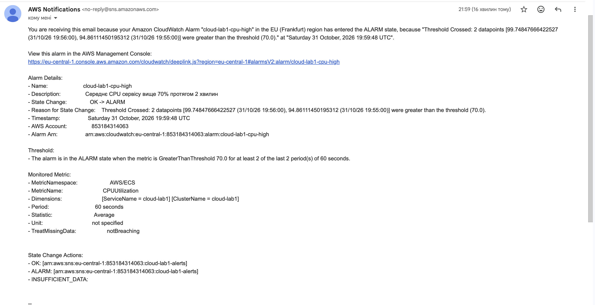
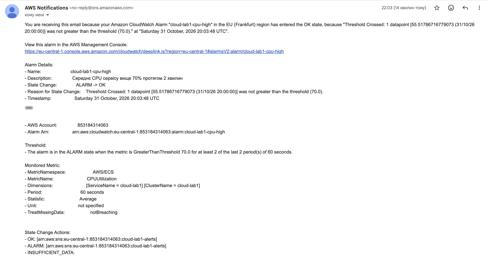

Email-алерти:

Алерт налаштований у Terraform, у файлі terraform/alerts.tf. Канал доставки це SNS-тема cloud-lab1-alerts з email-підпискою. Адреса пошти не зберігається в репозиторії і передається змінною TF_VAR_alert_email під час apply.

Умова спрацювання:

CloudWatch-тривога cloud-lab1-cpu-high: середнє завантаження CPU сервісу вище 70% протягом двох хвилин поспіль. Коли значення повертається нижче 70%, тривога переходить у стан OK і надсилається другий лист.

Чому саме така умова:

Автоскейлінг починає додавати екземпляри при 50%. Якщо CPU все одно доходить до 70% і тримається дві хвилини, значить сервіс не встигає за навантаженням і користувачі вже відчувають сповільнення. Тому такий поріг сигналізує про справжню проблему, а не про звичайну роботу автоскейлінгу. Дві хвилини потрібні, щоб короткий одноразовий сплеск не надсилав лист.

Листи під час тесту:

Тест запускався о 21:54 за Києвом (19:54 UTC). Усі часи нижче в UTC.

19:59:48 лист ALARM. CPU було 94,9% і 99,7%.
20:03:48 лист OK. Після додавання другого екземпляра CPU впало до 55,5%.
20:05:48 лист ALARM. CPU знову було понад 98%, бо навантаження росло, а третій екземпляр ще не запустився.
20:06:48 лист OK. CPU 60,8%.

Час реакції:

Від початку стабільного навантаження до першого листа ALARM пройшло приблизно 5-6 хвилин. Складається це з розгону навантаження, двох хвилин у умові тривоги, затримки метрик ECS у CloudWatch (2-3 хвилини) та часу доставки листа.

Для реального сервісу такий час неприйнятний, якщо сервіс критичний: за цей час користувачі вже отримували повільні відповіді й окремі помилки 5xx. Для сервісу, де перевантаження лише привід переглянути ємність, цього достатньо. Щоб реагувати швидше, можна було б вибрати умову за затримкою p95 (метрика балансувальника приходить швидше), зменшити період до однієї хвилини і додати інший канал, наприклад Telegram або SMS.

Спостереження:

Листи ALARM і OK прийшли по два рази, бо CPU коливалось навколо порогу 70% під час масштабування. Це нормально для тривоги з простим порогом, але в реальній системі це краще згладжувати довшим вікном оцінки.