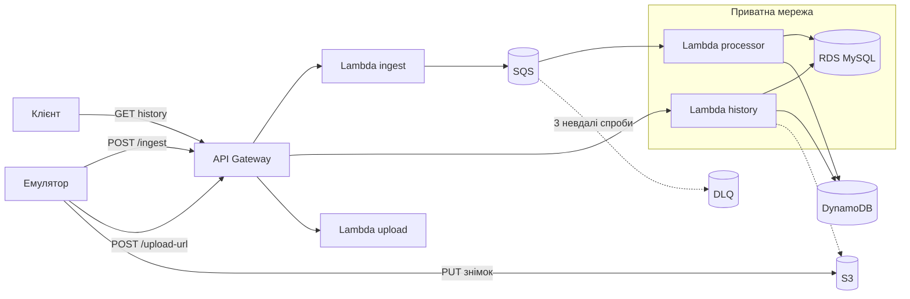

Архітектура

Емулятор датчиків шле вимірювання на API Gateway, звідти вони потрапляють у чергу SQS, а функція Lambda їх обробляє і зберігає в MySQL. Окремий запит повертає історію. Сирі дані додатково пишуться в DynamoDB, а знімки камери зберігаються в S3.

Що за що відповідає

- Емулятор (emulator/): три датчики (температура, вологість, освітленість) і камера. Єдина частина, яка працює як звичайна програма.
- API Gateway: публічний вхід. Маршрути POST /ingest, POST /upload-url, GET /sensors/{sensor_id}/history. Ліміт 500 запитів на секунду.
- Lambda ingest: перевіряє ключ і поля, кладе повідомлення в чергу, відповідає 202 або 400. Нічого не обробляє.
- SQS: черга між прийманням і обробкою, зберігає повідомлення до доби.
- Lambda processor: бере з черги по 10 повідомлень, не більше 5 запусків одночасно. Перевіряє значення, перераховує одиниці, позначає аномалії, пише в MySQL і в DynamoDB.
- DLQ: сюди потрапляє повідомлення після 3 невдалих спроб.
- Lambda history: віддає історію з MySQL або з DynamoDB (source=nosql). Для камери додає посилання на знімки.
- Lambda upload: видає підписане посилання для завантаження знімка.
- RDS MySQL: таблиця measurements, ключ (sensor_id, measured_at).
- DynamoDB: сирі вимірювання, докладніше в docs/NOSQL.md.
- S3: приватний бакет зі знімками, докладніше в docs/BLOB.md.

Шлях даних

1. Емулятор шле вимірювання, ingest перевіряє їх і кладе в чергу, відповідає 202.
2. Черга запускає processor. Він пише сирий запис у DynamoDB, а оброблений у MySQL. Якщо обробка не вдалась, повідомлення повертається в чергу, а після трьох спроб іде в DLQ.
3. Клієнт просить історію, history читає її з бази.
4. Камера спершу отримує посилання від upload, завантажує знімок у S3 і лише потім шле в чергу повідомлення з ключем файлу.

Мережа і безпека

База і функції processor та history стоять у приватних підмережах без виходу в інтернет. База приймає з'єднання тільки від групи безпеки цих функцій. До DynamoDB і S3 вони ходять через безкоштовні ендпоінти VPC. Бакет S3 приватний, знімки відкриваються лише за підписаним посиланням на 5 хвилин. Ключ API і пароль бази генерує Terraform, у репозиторії їх немає.

Витрати

Функції, черга, DynamoDB і S3 оплачуються за використання. Постійно коштує лише база RDS, тому після демонстрації роблю terraform destroy.

Terraform

network.tf (мережа, ендпоінти), database.tf (RDS), queue.tf (SQS і DLQ), ingest.tf (приймач), worker.tf (processor і history), nosql.tf (DynamoDB), blob.tf (S3 і upload), outputs.tf (адреси).