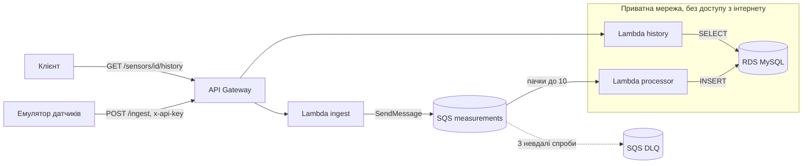

Архітектура:

Конвеєр обробки подій від датчиків: емулятор надсилає вимірювання через REST у чергу, serverless-функції обробляють їх і зберігають у базі, окремий REST-запит повертає історію.

Компоненти:

Емулятор (emulator/): єдиний компонент, що працює як звичайний процес. Три датчики (температура, вологість, освітленість), надсилає POST із JSON.
API Gateway (HTTP API): публічна точка входу, маршрути POST /ingest і GET /sensors/{sensor_id}/history, ліміт 500 запитів на секунду.
Lambda ingest (functions/ingest): перевіряє ключ x-api-key, валідує поля, кладе повідомлення в чергу і відповідає 202 або 400. Нічого не обробляє.
SQS cloud-lab3-measurements: буфер між прийманням і обробкою, зберігає повідомлення до 24 годин.
Lambda processor (functions/worker/processor.js): запускається чергою, пачки до 10 повідомлень, не більше 5 одночасних запусків. Перевіряє діапазони, перераховує одиниці, позначає аномалії, записує в базу ідемпотентно.
SQS DLQ cloud-lab3-measurements-dlq: сюди потрапляють повідомлення після 3 невдалих спроб обробки.
Lambda history (functions/worker/history.js): читає історію з бази.
RDS MySQL: таблиця measurements, первинний ключ (sensor_id, measured_at).

Потік даних:

1. Емулятор надсилає вимірювання, API Gateway передає запит функції ingest.
2. Ingest перевіряє запит і кладе його в чергу, відповідає 202 за кілька десятків мілісекунд.
3. Черга запускає processor, він обробляє пачку і пише результат у базу. Невдалі повідомлення повертаються в чергу, після трьох спроб потрапляють у DLQ.
4. Клієнт запитує історію датчика, API Gateway викликає history, яка читає базу.

Мережа і безпека:

База і функції processor та history працюють у приватних підмережах без інтернет-шлюзу і NAT. Група безпеки бази приймає з'єднання лише від групи безпеки функцій. Ключ API генерується Terraform, зберігається в SSM Parameter Store (для ingest) і як змінна середовища (для history), у репозиторії його немає. Пароль бази теж генерується Terraform.

Модель витрат:

Усі обчислення виконують функції Lambda, які запускаються подіями і оплачуються за виклик. Постійно оплачується лише база RDS, тому після демонстрації виконується terraform destroy.

Terraform:

terraform/main.tf: провайдери. variables.tf: змінні. network.tf: мережа і групи безпеки. database.tf: RDS. queue.tf: черги SQS і DLQ. ingest.tf: приймач (Lambda, API Gateway, ключ). worker.tf: processor, history і тригер від черги. outputs.tf: адреси.