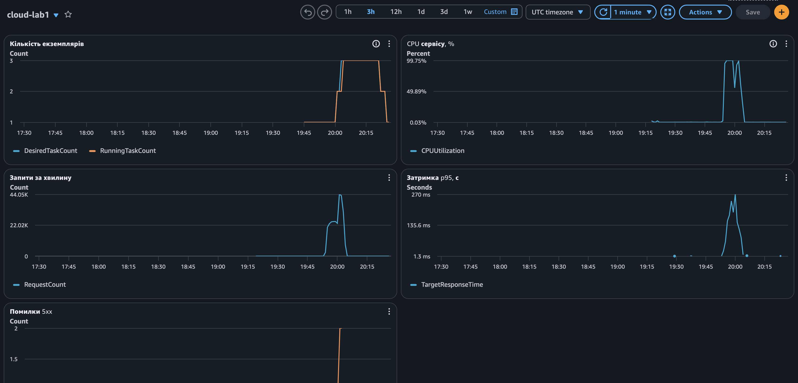

Автоматичне масштабування:

Масштабування налаштоване в Terraform, у файлі terraform/autoscaling.tf. Воно працює для ECS сервісу cloud-lab1.

Параметри:

Мінімальна кількість екземплярів: 1.
Максимальна кількість екземплярів: 3.
Метрика: середнє завантаження процесора по сервісу.
Цільове значення: 50 відсотків.
Cooldown при збільшенні кількості екземплярів: 60 секунд.
Cooldown при зменшенні: 120 секунд.

Чому саме такі значення:

Мінімум 1, бо сервіс має працювати завжди, а кожен додатковий екземпляр коштує грошей. Для звичайного навантаження одного екземпляра достатньо.

Максимум 3, бо за умовою лабораторної можна не більше 4 екземплярів. Три дають достатній запас, і витрати під час тесту лишаються невеликими.

Метрика процесор, бо під навантаженням застосунок першим упирається саме в нього, і його просто виміряти.

Цільове значення 50 відсотків вибране з запасом. Новий екземпляр запускається не одразу, на це йде десь хвилина. Якщо поставити 80 або 90 відсотків, перший екземпляр встигне перевантажитись до того, як з'явиться другий. При 50 відсотках масштабування починається раніше, і сервіс не доходить до межі.

Що таке cooldown:

Cooldown це пауза після масштабування. Поки вона триває, система не виконує наступну дію в той самий бік. Це потрібно, бо новому екземпляру треба час, щоб запуститись і почати приймати запити, а до цього середнє завантаження ще показує старе високе значення. Без паузи система могла б додати зайві екземпляри.

При збільшенні пауза 60 секунд, щоб реагувати швидко. При зменшенні 120 секунд, щоб не прибирати екземпляри через короткий спад навантаження.

Що буде, якщо cooldown дорівнює нулю:

Система реагує на кожну зміну метрики без пауз. Завантаження піднялось, екземпляр додали. Воно трохи впало, екземпляр прибрали. Потім воно знову піднялось, і екземпляр знову додають. Екземпляри постійно запускаються і зупиняються, сервіс працює нестабільно, а ми платимо за зайві запуски. Крім того, система може додати забагато екземплярів, бо не чекає, поки попередні почнуть працювати і знизять навантаження.

Масштабування під час тесту:

Скріншот дашборда за час тесту:

Часи нижче вказані в UTC (за Києвом на дві години більше).

Початок навантаження: близько 19:54. Запитів за хвилину зростає від нуля до 20-40 тисяч.
Перетин порогу: близько 19:55. Середнє CPU сервісу доходить до 95% і далі до 99%, тобто значно вище цілі 50%.
Поява другого екземпляра: о 20:00:03. Бажана кількість задач росте з 1 до 2.
Поява третього екземпляра: о 20:03:03. CPU після другого екземпляра впало лише до 55%, тому третій додався пізніше.
Видалення екземплярів: о 20:21:10 з 3 до 2, о 20:24:10 з 2 до 1. Це приблизно через 17-20 хвилин після завершення тесту.

Балансувальник зафіксував дві помилки 5xx під час перевантаження, а k6 показав 5 запитів, що не повернули код 200, з приблизно 270 тисяч.

Чому новий екземпляр з'являється із запізненням:

Між перетином порогу (19:55) і другим екземпляром (20:00) минуло близько п'яти хвилин. Причини такі:

1. CloudWatch отримує метрику CPU раз на хвилину, і вона з'являється із затримкою кількох хвилин. Графік дашборда відстає від реальних подій приблизно на 3 хвилини, тому точні моменти масштабування взяті з журналу Application Auto Scaling.
2. Політика масштабування за ціллю не реагує на одну точку вище порогу. Вона чекає кілька точок поспіль, щоб короткий сплеск не запускав нові екземпляри.
3. Після рішення Fargate має завантажити образ, запустити контейнер і пройти перевірку здоров'я, і лише тоді балансувальник починає надсилати на нього трафік. Це займає приблизно хвилину.

Чому видалення значно пізніше за спад навантаження:

Тест закінчився о 20:04, а екземпляри почали зникати о 20:21:10. Це навмисна несиметрія. Політика зменшує кількість екземплярів обережніше, ніж збільшує, бо додати екземпляр дорого за часом (близько хвилини), а прибрати його швидко, і помилка в цей бік швидко відчувається користувачами. Тому CloudWatch вимагає, щоб CPU було значно нижче цілі (нижче 45%) приблизно 15 хвилин поспіль, і додатково діє пауза scale-in 120 секунд на кожен крок. Це захищає від ситуації, коли навантаження коротко впало, екземпляр видалили, а воно знову виросло.