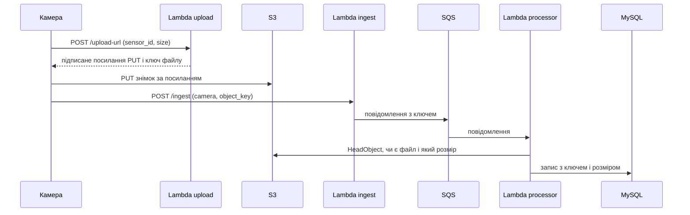
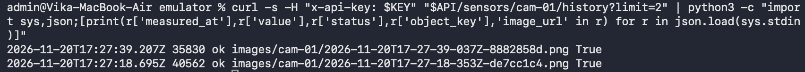
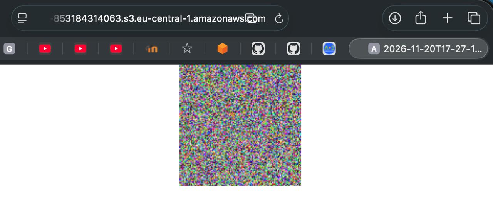
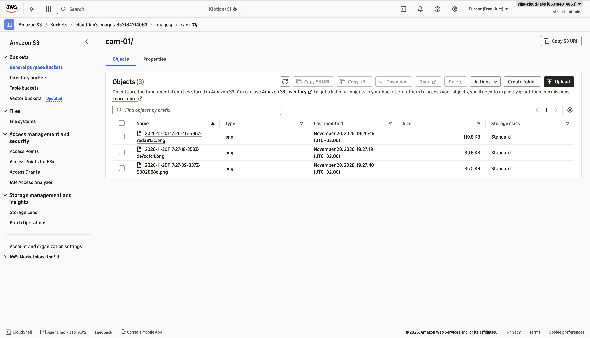
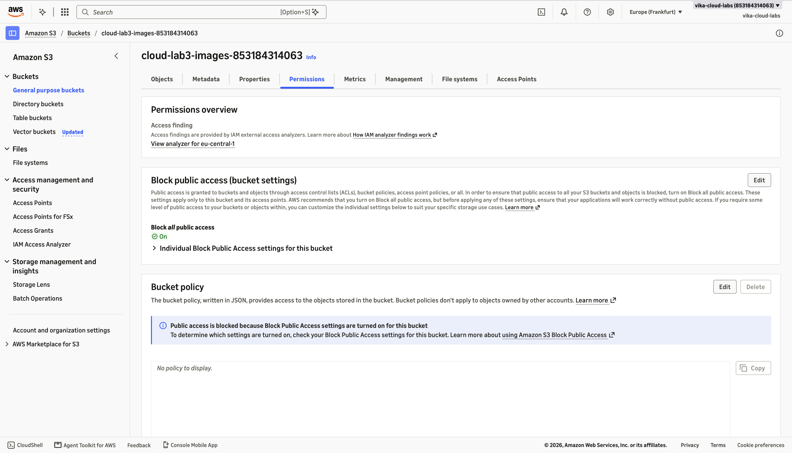

Знімки камери в S3

Четвертий датчик це камера (cam-01). Раз на 10-30 секунд вона робить знімок (PNG до 1 МБ) і завантажує його в приватний бакет S3. Через чергу знімок не йде і в базі не лежить, в базі зберігається тільки ключ файлу.

Послідовність

1. Камера просить у функції upload посилання і вказує розмір знімка. Функція перевіряє ключ API і розмір (до 1 МБ), вигадує ключ файлу images/{sensor_id}/{час}-{суфікс}.png і повертає підписане посилання на PUT на 5 хвилин.
2. Камера завантажує файл на це посилання.
3. Тільки після цього камера шле звичайне повідомлення в /ingest з полем object_key, і воно йде в чергу.
4. Processor перевіряє, що файл справді є в S3 і не більший за 1 МБ, і записує в базу ключ, розмір і статус. Якщо файлу немає, повідомлення повторюється, а після трьох спроб іде в DLQ.

Історія камери

GET /sensors/cam-01/history повертає для кожного запису object_key і image_url, це підписане посилання на читання на 5 хвилин. Бакет приватний, без такого посилання файл не відкрити. Коли час спливає, посилання перестає працювати, а новий запит історії дає нове.

Історія камери :

Знімок, відкритий у браузері за посиланням з відповіді:

Знімки в бакеті:

Публічний доступ до бакета заблоковано:

Чому знімок не йде через чергу

Повідомлення SQS не може бути більшим за 256 КБ, а знімок до 1 МБ туди не влізе. До того ж у JSON його довелося б кодувати в base64, і він став би ще на третину більшим. Черга створена для коротких повідомлень, а для великих файлів є сховище.

Чому знімок не лежить у базі

Файли в базі роздувають таблицю і резервні копії, забивають пам'ять бази і уповільнюють запити. Диск RDS дорожчий за S3 і гірше масштабується. Тому в базі лежить тільки короткий ключ, а сам файл у S3.

Що таке підписане посилання

Це звичайне посилання на файл у S3, до якого додано підпис. Підпис створює функція своїми правами, і в ньому записано, який файл, яка дія (PUT або GET) і до коли діє. S3 перевіряє підпис і дозволяє саме цю одну дію, поки не мине час. Камері не потрібні ні ключі від AWS, ні ролі. Посилання не можна підмінити, бо з іншим файлом чи дією підпис не збігається. Якщо воно потрапить не до того, воно діє лише 5 хвилин і лише для одного файлу. Тому бакет можна тримати повністю закритим.

Обмеження

Посилання на PUT саме по собі не обмежує розмір файлу. Тому розмір перевіряється двічі: upload не видає посилання, якщо size більше 1 МБ, а processor після завантаження дивиться на справжній розмір. Жорстко обмежити розмір на боці S3 можна через підписаний POST з умовою content-length-range, але для лабораторної взято простіший PUT.