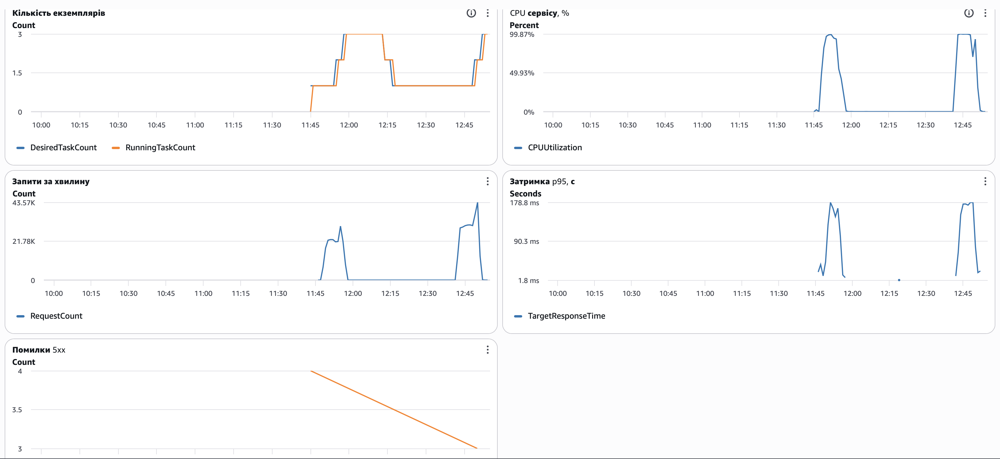

Кешування читання

Що кешується і як:

Кешується операція читання товару за ID (GET /api/products/ID). У навантажувальному сценарії вона найбільш завантажена: на кожну ітерацію припадає один запис і дев'ять читань за ID. Список товарів не кешується: він повертає всю таблицю, яка росте під час тесту, і має штучну затримку 500 мс.

Використана схема cache-aside у функції getProductById у файлі api/products.js:

1. Сервіс перевіряє кеш за ключем product:ID.
2. Якщо запис є і термін його дії не минув, повертає його із заголовком X-Cache: HIT.
3. Інакше читає товар з бази, зберігає в кеш на 30 секунд і повертає із заголовком X-Cache: MISS.

Кеш це Map у пам'яті процесу (файл config/cache.js). Максимум 5000 записів, найстаріші витісняються. Заголовок запиту Cache-Control: no-cache повністю обходить кеш, тому той самий сервіс можна перевірити без кешу.

Як порівнювалось:

Сценарій із завдання 2 (60 користувачів, 10 хвилин) запущено двічі на тій самій інфраструктурі, кожного разу з одного екземпляра. Перший раз без кешу (k6 з прапорцем NOCACHE=1), другий раз з кешем. В обох запусках спрацював автоскейлінг (до 3 екземплярів).

Результати:

Показник  Без кешу/З кешем 
Запитів за тест  196 420 / 288 910 
Запитів за секунду  327 / 481 
Затримка p50  118,7 мс / 93,7 мс 
Затримка p95  257 мс / 202 мс 
Затримка p99  354,7 мс / 306,7 мс 
Запитів до бази за тест  196 420 / 66 883 
Запитів до бази за секунду  327 / 111 
CPU бази, середнє  10,6% / 8,5% 
Підключень до бази, середнє  13 / 13 
Невдалих запитів  0 / 3 

Запити до бази з кешем це 28 891 запис плюс 37 992 промахи кешу. Кількість підключень однакова, бо пул з'єднань тримає їх відкритими незалежно від навантаження.

Скріншот дашборда за обидва тести. Лівий пік це тест без кешу, правий пік це тест з кешем. Пік запитів зріс із 30 до 43 тисяч за хвилину.

Частка влучань у кеш:

Із 260 019 читань 222 027 були влучаннями, тобто 85,4%. Висока частка пояснюється тим, що кожен користувач читає свій новий товар і вісім сусідніх, тож ті самі записи читають багато разів.

Висновки:

Кеш скоротив кількість запитів до бази на 66%, збільшив пропускну здатність на 47% і зменшив p95 приблизно на 21%. Виграш помірний, бо база й без кешу була майже вільна (CPU близько 10%). Вузьким місцем було CPU самого застосунку, яке витрачається на обробку запиту й формування відповіді навіть коли дані беруться з кешу.

Скільки часу клієнт може бачити застарілі дані:

У поточному API товари не змінюються і не видаляються (є лише створення), тому закешований товар не може застаріти. Якби з'явилась операція зміни, клієнт міг би бачити стару версію до 30 секунд, тобто до кінця терміну дії запису в кеші (TTL).

Як цей час зменшити: видаляти ключ з кешу під час запису, зменшити TTL або додавати в ключ номер версії запису.

Чому кеш у пам'яті процесу погано працює з кількома екземплярами:

Кожен екземпляр має власний кеш. Це дає такі проблеми:

1. Кожен новий екземпляр починає з порожнім кешем, і доки він прогріється, запити йдуть у базу. У нашому тесті екземпляри з'являлись посеред навантаження.
2. Після зміни даних один екземпляр може віддавати нове значення, а інший старе, і клієнт бачитиме різні відповіді залежно від того, куди потрапив запит.
3. Інвалідацію не можна розіслати всім екземплярам: видалити запис можна лише в тому процесі, який обробив запис.
4. Кеш зникає, коли екземпляр перезапускається або видаляється під час зменшення навантаження.
5. Пам'ять кешу береться з пам'яті самого застосунку, а на нашому малому контейнері її лише 512 МБ.

Рішення: спільний кеш, наприклад Redis, до якого звертаються всі екземпляри.