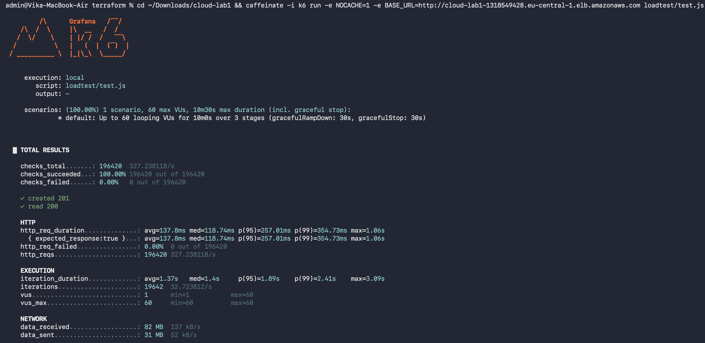
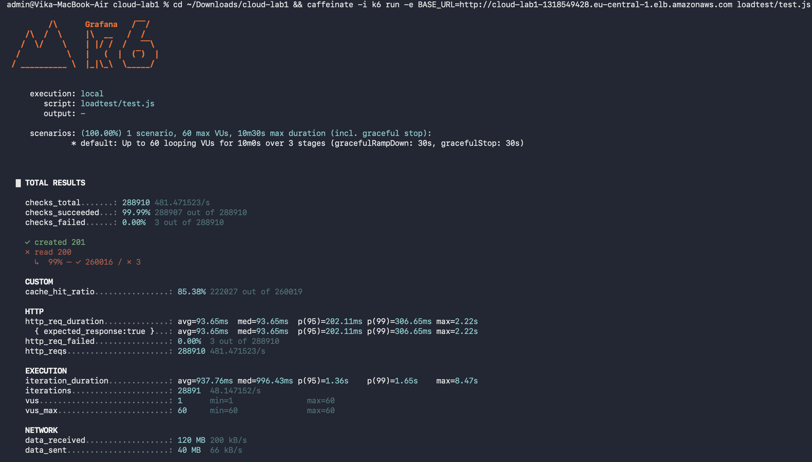

Навантажувальне тестування:

Тест написаний на k6, сценарій лежить у loadtest/test.js.

Сценарій:

Кожен віртуальний користувач за один візит робить 1 запис і 9 читань: створює товар (POST /api/products), потім читає щойно створений товар і ще вісім сусідніх (GET /api/products/:id). Співвідношення записів і читань 10 до 90.

Фази:

1. Зростання від 0 до 60 користувачів за 3 хвилини.
2. Утримання 60 користувачів 5 хвилин.
3. Спад до 0 за 2 хвилини.

Разом 10 хвилин.

Команда запуску:

k6 run -e BASE_URL=http:// loadtest/test.js

Запуск без кешу:

k6 run -e BASE_URL=http:// -e NOCACHE=1 loadtest/test.js

Результати:

Показник  Без кешу / З кешем
Запитів усього  196 420 / 288 910
Запитів за секунду  327 / 481
Невдалих запитів  0 / 3
Затримка p50  118,7 мс / 93,7 мс
Затримка p95  257 мс / 202 мс
Затримка p99  354,7 мс / 306,7 мс
Підсумки k6 без кешу:

Підсумки k6 з кешем:

Висновок:

З кешем сервіс обробив приблизно на 47% більше запитів за секунду, а затримка p95 впала з 257 до 202 мс. Виграш помірний, бо вузьке місце тут процесор застосунку, а не база даних. Кеш лежить у пам'яті окремо в кожного екземпляра, тому під час масштабування до 2-3 екземплярів частина запитів потрапляє в порожній кеш.

Під час обох тестів спрацювало автомасштабування, дашборд і лист сигналізації описані в docs/AUTOSCALING.md та docs/ALERTS.md. Порівняння кешу на дашборді в docs/CACHE.md.