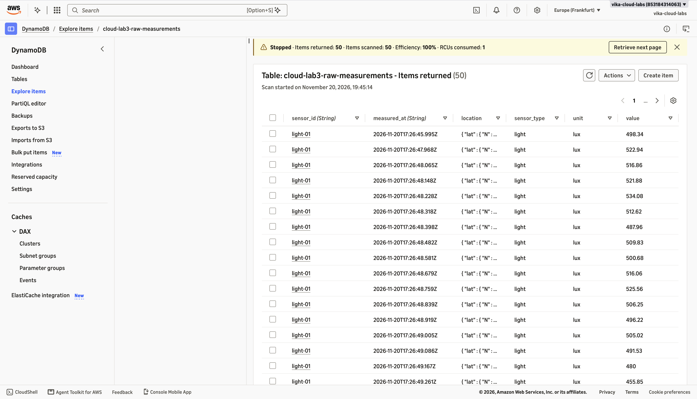
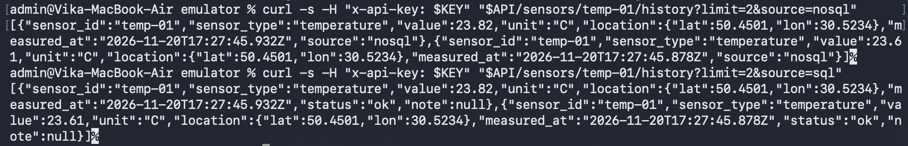

Нереляційна база (DynamoDB)

Кожне вимірювання в сирому вигляді пишеться в таблицю DynamoDB cloud-lab3-raw-measurements. Ключ розділу sensor_id, ключ сортування measured_at. Запис робить processor перед обробкою (terraform/nosql.tf).



Читання історії

GET /sensors/{sensor_id}/history?source=nosql читає з DynamoDB, без параметра або з source=sql з MySQL. У відповіді з DynamoDB нема status і note, бо їх рахує обробка.



Запит

MySQL:

```
SELECT ... FROM measurements WHERE sensor_id = ? AND measured_at BETWEEN ? AND ? ORDER BY measured_at DESC LIMIT ?
```

DynamoDB:

```
KeyConditionExpression: sensor_id = :s AND measured_at BETWEEN :a AND :b
ScanIndexForward: false
Limit: ліміт
```

Для історії одного датчика вони однакові.

Що де зручно

MySQL зручніший, коли запит не за ключем: усі аномалії по всіх датчиках, середнє по годинах, порівняння датчиків.

У DynamoDB такі запити дорогі або неможливі: фільтр за не ключовим полем працює після читання, запит по всіх датчиках це Scan усієї таблиці, а агрегацій і JOIN нема. Зате читання за ключем швидке за будь-якого обсягу.

Масштабування запису

MySQL пише через один сервер і має мало з'єднань (близько 85), тому ростуть через більший сервер або RDS Proxy.

DynamoDB розподіляє дані по розділах за sensor_id, тож нові датчики просто йдуть у нові розділи, з'єднань нема.

Висновок

Для потоку телеметрії краще DynamoDB: запис безперервний, обсяг росте з датчиками, а головний запит це історія датчика за проміжок часу. MySQL потрібен для аналітики по багатьох датчиках. У роботі є обидва: сирі дані в DynamoDB, оброблені в MySQL.